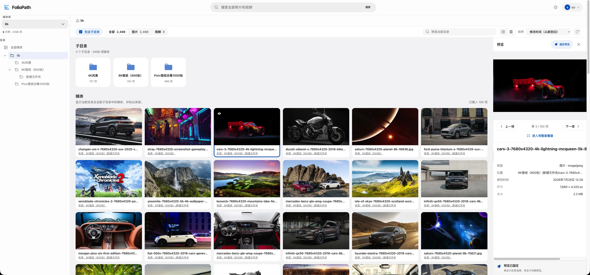
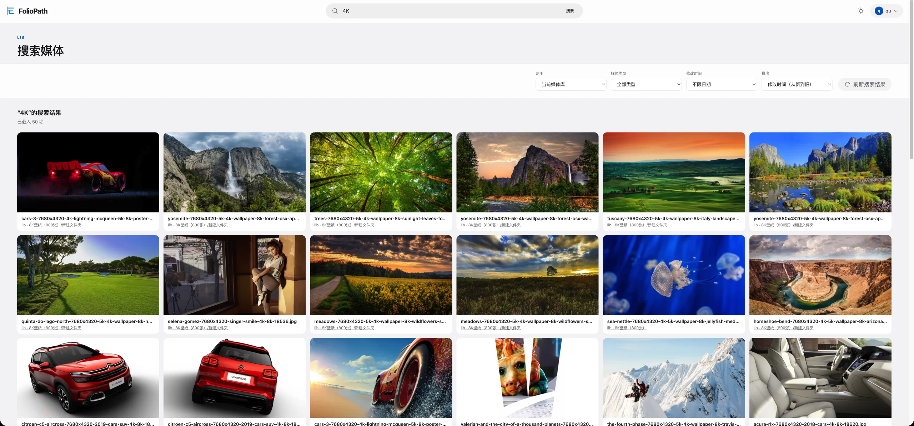
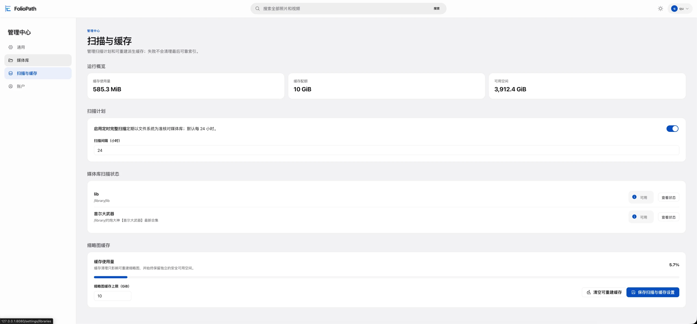
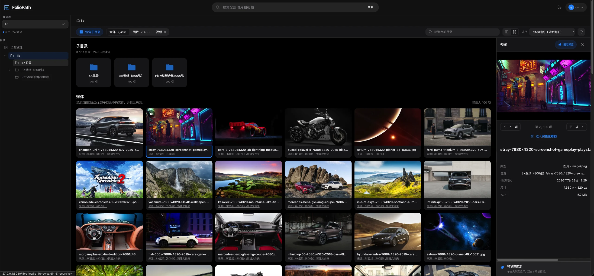

# FolioPath

本轮本地候选 `post-mvp5-local-rc-20261026.3` 已完成约定的工程回归、原生AMD64／ARM64验证及安装／升级材料；实际发现的窄屏长标题和深色预览按钮对比度已修复。最终嵌入UI矩阵为231通过、54条件跳过、0失败。**尚未正式发布，6010也未更新到候选**；源码未提交为干净release commit，AI打包流程偏差及暂缓门禁仍如实保留。下文工作区后续人物功能不自动纳入本次候选。[固定范围、归档与最终证据](docs/changes/VERIFY-2026-10-26-release-candidate.md)。

界面文案已统一清理工程说明，覆盖账户、媒体库、设置、日志及浏览/搜索等页面；实际搜索来源和识别文字保留。见[更新记录](docs/changes/FIX-2026-10-26-product-language.md)。

OCR全文搜索（POST-MVP-5候选）：显式配置OCR部署身份并按库启用、完成处理后，可选择“图片文字”或“全部来源”，在预览查看匹配文字原文。支持短中文、英文及多词字面匹配；只检索当前图片版本。OCR默认关闭，开关和任务在“智能分析”中按库管理。6010的pixiv补齐已结束：998张处理成功、1张源文件损坏、0张待处理，已完成结果与历史任务保留，其余库未启用。此为功能验收，不代表正式识别准确率通过；见[部署记录](docs/changes/DEPLOY-2026-10-26-ocr-6010.md)。

OCR 后台与管理 API 为显式部署候选：只有配置独立 `ocr.identity` 才注册，各库默认关闭，需管理员明确开库并提交任务；支持保留进度的中断恢复、固定失败原因和分批清理。OCR全文搜索见CR-2026-051，按库管理界面见CR-2026-052；原6010当前部署状态见上述记录。后台合同见[记录](docs/changes/CR-2026-050-ocr-runtime-management.md)。

人物合并前会检查并说明阻止原因，提供最多三组冲突照片核对入口；离线或待复核的禁止关系仍会阻止合并，检查结果不绕过保存时的版本校验。

单图人脸整理可明确选择两张属于不同人物的人脸，标记为不同人物，防止误合并；已有关系可见，成功后可受版本保护地撤销，原照片和归属不因此移动。

人物移出、移动或合并响应不确定时，可在当前页面恢复同一请求核对结果；照片消失或源人物不可读也不会丢掉恢复入口，确认成功后仍可撤销。

人物工作区可核对并撤销本页已确认的人脸归类、排除、移出或合并；后续整理变化时拒绝覆盖，原始照片始终不变。

单张照片的人脸整理需先明确选择并确认来源和目标；排除核对人工归属版本，避免旧请求覆盖新整理。未知响应可在确认框内同操作重试，图片加载失败时暂停写入。

已命名人物目录显示已确认照片预览，支持在主区搜索和翻页；同名人物保持独立，照片暂不可用时仍保留名称与整理入口。创建人物会先生成空条目，需要另行明确归类人脸。

人物分组目录支持“待处理 / 全部分组”，按当前媒体库和类型显示真实剩余组数、人脸数；整理完的组可在全部中查看。修改人工归类后旧分页可能失效，页面可返回第一页；不会删除或改动照片。


库切换菜单以浮层展开；标签侧栏使用紧凑目录行与数量徽标，列表独立滚动，搜索和媒体筛选保持可见。
浏览页将布局与缩略图大小放在同一工具组，标题、媒体范围和操作区分层展示。
搜索结果将查询标题、已载入数量与筛选集中展示，图片更早进入首屏；分析覆盖与失败状态仍如实显示。

界面采用分层工作台：蓝灰画布、独立功能侧栏、白色内容卡片和浮动媒体预览；管理与媒体页面保持统一的导航和移动抽屉。

搜索、人物、收藏和标签工作区使用各自的功能侧栏：左侧选择与筛选，中间查看结果；手机通过对应工具抽屉操作。
人物已命名列表汇总全部库，待整理人物组与收藏仍按媒体库展示。

搜索支持“全部来源”融合检索：文件名、库内路径与图片画面语义由服务端合并去重，卡片显示真实来源，预览可查看“为什么匹配”。字面模式保留原排序；视频画面继续使用独立语义入口；OCR按显式部署与库启用条件检索识别文字并展示具体行片段。
融合搜索已在停写完整备份后更新原6010，并完成中文/路径/分页/手机及原数据保护验收，详见[部署记录](docs/changes/DEPLOY-2026-10-25-fused-search-6010.md)。

人物详情将名称、合并和照片整理分开：多人脸照片需明确选择人脸，移动/移出有确认，合并需核对目标并确认；只改变人工关联，照片与其他人脸保留。本轮开发与Docker验证、原6010是否部署的实际状态见[人物整理记录](docs/changes/CR-2026-036-person-review-safety.md)。
待整理分组也按照片展示并逐脸确认，区分已归类/已排除状态；新建空人物不会自动归类整个分组。分组类型和列表/成员分页往返保持。此版已通过隔离Docker验证，尚未更新6010，见[分组审核记录](docs/changes/CR-2026-037-cluster-review.md)。

原6010的153类自动标签补齐已结束：当前身份8690成功、10已知源问题按用户要求暂留、0待处理；22张目标大PNG均已完成输入分析。人工整理、删除抑制、人物与语义向量保持，见[最终记录](docs/changes/DEPLOY-2026-10-24-photo-tags-153.md)。

See [verification and deployment boundary](docs/changes/FIX-2026-10-23-search-mode-guidance.md);
[large PNG input compatibility](docs/changes/FIX-2026-10-23-semantic-large-png.md) now has a tested,
opt-in `image_preprocessing: "png-v4"` candidate (64 MiB / 40 MP). It was deployed to local 6010 on 2026-10-24
after all previous jobs finished and a verified full stopped backup. All four new-generation image-semantic jobs
finished by 2026-10-24 09:16 +08:00: 8,690 successful images and 10 source-input failures out of 8,700 processed.
All 22 target large PNGs have verified current-generation embeddings matching their source fingerprints.
The remaining inputs require external restoration or correction; they were not marked successful.
Old vectors and curation hashes matched the pre-update snapshot; that semantic rollout did not change tagging input or failures.
The subsequent independent tagging upgrade is described above.

Development and Docker build/test tooling use Node.js **24.22.1 LTS** and npm **11.19.1**.
CI follows `.node-version`; Docker sources pin the matching tag and digest. Both local and Docker
frontend suites pass 414 tests; the existing dependency security audit remains unresolved.
The Go/Python runtime services do not need Node. See [toolchain verification](docs/changes/FIX-2026-10-23-node24-lts.md).

An optional pinned multilingual profile now supports `XLM-Roberta-Large-Vit-B-16Plus` (640 dimensions).
The local 6010 instance uses it; its new-space image indexing has finished with the source exceptions above.
Face and automatic-tag identities remain independent; stored category keys stay stable.
See [model setup and actual verification limits](docs/changes/CR-2026-032-multilingual-semantic-model.md).

The updated local 6010 app supports Chinese, English and bilingual AI labels and
category lookup. This browser preference does not rename existing tags or reprocess
photos; manual names stay literal. Its independent JoyTag photo policy expands 92
to 153 reviewed classes without changing search/face identities; its 6010 rollout
finished with 8,690 successful images and the 10 deferred source exceptions. Historical 92-class jobs retain their recorded outcomes. See
[local Docker evidence and deployment status](docs/changes/CR-2026-033-localized-photo-tags.md).
Feature smoke tests do not establish model accuracy or release approval.

Planned shutdown now hands back exact image-semantic, face and automatic-tag claims
after their processor and heartbeat stop, preserving job IDs and committed progress.
The existing crash limit is unchanged. Local 6010 was fully backed up and upgraded
to schema 44, and its original tasks resumed. See [handoff and deployment evidence](docs/changes/FIX-2026-10-23-planned-job-handoff.md).

The large-image native-memory repair candidate shares one cancellable working slot across thumbnails and AI
preprocessing, with deterministic cleanup; the reproduced synthetic Docker cases pass without changing model pixels.
It replaced the local 6010 application after all four backfill jobs reached terminal state; constrained capacity/long-term
gates remain open. The 8,493 attempted items include 41 source failures, not 8,493 successes. See [repair evidence](docs/changes/FIX-2026-10-23-main-face-memory.md) and
[per-image source failures](docs/changes/FIX-2026-10-23-face-source-diagnosis.md).

Operators may explicitly opt out of per-container RAM/swap caps by layering
[`compose.ai.unlimited-memory.yaml`](compose.ai.unlimited-memory.yaml) after the base AI Compose file.
The local 6010 instance uses this option at the user's request; host/VM memory still limits it.
This is not an OOM fix or constrained-budget acceptance. See [instructions](docs/ai-compose.md#操作者显式取消容器内存上限).

For AI memory planning, allow about **2 GiB for face analysis or photo tagging**, **3 GiB for OCR**, or
**6 GiB for multilingual search and the complete AI profile**. Separately reserve roughly **512 MiB–1 GiB for
the main application**, with more headroom for scanning and large images, plus the operating system and other
services. Consider an **8 GiB dedicated machine**, or **16 GiB when sharing with Immich and other services**.
These are engineering headroom suggestions, not measured minimums or program limits. Small, serial CPU tests
observed AI-container peaks of 2.82 GiB on AMD64 and 3.86 GiB on ARM64 for the earlier complete profile.
The final `rc-20261026.7` ARM64 image reached 3.92 GiB in a separate 6 GiB serial test; these figures
do not prove that a whole 4 GiB machine is sufficient. See the [measured scenarios and limits](docs/ai-compose.md#ai-功能内存参考).

People-analysis failures now have an expandable, privacy-safe summary: task interruption is distinguished
from individual image failures, with fixed reasons and up to 20 samples. Missing-only retry preserves successful
results and manual curation; old failures without recorded reasons remain explicitly unknown. In-flight face
tasks wait up to 60 seconds for transient scans. The earlier schema-43 diagnostics upgrade preserved
existing media and curation. See [verification and limits](docs/changes/FIX-2026-10-23-ai-failure-diagnostics.md)
and [current progress](docs/features/intelligent-media-discovery-remaining-tasks.md); no release approval is implied.
The earlier 6010 check reproduced a scan-worker exit. A later isolated reproduction confirmed that opening a
live Docker Desktop WAL database from macOS can trigger I/O short reads and stop the worker. Online checks now
run inside the application container with `docker exec <app> /app/foliopath database-check` (read-only, bounded,
fixed output); never open the live file from the host. See [the repair and verification limits](docs/changes/FIX-2026-10-23-scan-worker-exit.md).
This fixes the reproduced maintenance path, not every possible I/O failure or an unlimited-duration stability claim.

Automatic photo tagging and manual-tag protection are now implemented under the accepted
[CR-2026-031 plan](docs/changes/CR-2026-031-automatic-photo-tags.md) and
[ADR-0021](docs/adr/0021-bounded-inference-and-automatic-tags.md). A separate per-library switch enables
bounded tagging with a deployment-pinned JoyTag model, without a candidate vocabulary or approval queue.
Photo tags show AI/manual provenance; manual additions survive reprocessing, and removed tags stay suppressed
until explicitly restored. A library-scoped sidebar cloud counts distinct still images and animations, excludes
videos, and filters that library. These T1/T2 cloud features are now joined by the T3/T4 tagging implementation;
they are not a claim that every deployment has been upgraded.

The earlier co-resident model experiment exceeded the memory budget. The new request-scoped inference child
passed [18 real requests](spikes/automatic-tags/SCHEDULED-RESULT.md) at the unchanged 2304 MiB limit, peaking at
2084.23 MiB with no OOM; this historical English 512-dimensional profile does not cover the current multilingual
model or OCR. True TCP disconnect also reaped the child. Production Go packages, integration,
contract and architecture tests passed with `CGO_ENABLED=0` and an extended-volume temporary directory;
63 frontend files / 387 tests, types, generation, architecture checks and Storybook passed. The final local
two-service smoke passed on the final image pair: restart during inference, cancellation without tag changes
or automatic retries for 35 seconds, AI outage/recovery, disabled-state persistence, unchanged original hashes
and no OOM. Real UI tests also covered per-library switches, manual add/remove/promotion, reprocessing and
restart persistence; 390/768/1440/1920px layouts had no overflow and the final fresh browser tab had zero errors.
This is not a claim that unrestricted `make lint` / `make test`, general-photo quality, capacity, AMD64,
the full browser matrix or release acceptance passed. These are the earlier automatic-tag test results;
the existing 6010 instance was subsequently updated, as recorded in current progress.
Exact images, retained test environment and prior failures are recorded in
[the final CR evidence](docs/changes/CR-2026-031-automatic-photo-tags.md) and
[current progress](docs/features/intelligent-media-discovery-remaining-tasks.md).

AI settings uses three stable sections: **Features / Processing tasks / Service & models**.
Search, people and automatic-tag switches stay scoped to the selected library; model configuration is global
and read-only. People and photo tags have separate result entry points. Recent operations combine saved browser
records, the selected library's active tagging operation and restored downloads, not a complete server job list.
Disabling or cancelling preserves committed tags. Terminal failure/cancellation blocks automatic readmission
for the same model until an explicit recovery action; confirmed full reprocessing can retry recorded image
failures without undoing manual edits. Legacy vocabulary/review APIs remain compatible, but are no longer the
main tagging workflow. See the [deployment contract](docs/deployment.md) and
[UI scope record](docs/changes/FIX-2026-10-22-ai-information-architecture.md).

可选 AI 双容器交付候选：使用独立 [`compose.ai.yaml`](compose.ai.yaml)，由 Compose 配置预加载镜像和只读模型缓存，不使用模型商店。**P5 5/5 本地工程交付验收通过，P6 3/3 核对完成**；当前发布结论仍为 **No-Go**，原因包括候选漏洞、模型授权/provenance 及延期质量容量门禁。见 [配置说明](docs/ai-compose.md)、[P5 证据](docs/evidence/int-001/p5-delivery-security-2026-09-17.md)和 [P6 最终复核](docs/evidence/int-001/p6-final-verification-2026-09-17.md)。

P4 大 JPEG 语义兼容修复候选：在源媒体预算内先进行 JPEG 解码缩小，再分析；工作像素/输出限制不放宽，非 JPEG 上限不变。预处理升级会形成新语义代次，需要重新分析及生成建议。验证结果见[修复记录](docs/changes/FIX-2026-09-17-semantic-large-jpeg.md)，不是发布完成。

P4 **本轮验收通过，已完成**（2026-09-17 用户确认）：按约 100 样本工程范围收口，人工质量校准及原规模联合容量要求延期，不记测试通过；不代表发行完成。见 [P4 收口台账](docs/features/intelligent-media-discovery-p4-closeout.md)。

2026-09-16 最新复查：P2 6/6、P3 9/9 按既定范围修复复验通过，包括人物移动、标签冲突/分页、键盘焦点、三浏览器及独立视觉回归、完整故障恢复和备份回滚。剩余清单 18/34 关闭、16 项保留；质量、容量与发布仍未完成。[最终证据与边界](docs/evidence/int-001/p2-p3-final-recheck-2026-09-16.md)。

P3 修复：AI 中断后，模型恢复即可直接重试人脸分析；部署身份不匹配不再保留虚假的“模型可用”状态，旧索引和人物关系保留。共享搜索栏支持在已有搜索/目录条件下替换关键词，普通文件名搜索不依赖 AI 服务。[本地 Docker 验收与测试边界](docs/evidence/int-001/p3-acceptance-2026-09-16.md)。

开发候选：独立 AI 部署支持可选人脸模型身份、代次准入、有界分析、匿名组和人工人物管理，详见[配置说明](docs/deployment.md)。P2 非空人物功能已通过本地 Docker 正式 API/Chromium 验收；清理/重建保留人工关系与原媒体。测试使用生成的虚构人脸，不代表质量校准，自动整组归类仍禁用。质量、容量和发布未完成；当前进度见[剩余任务](docs/features/intelligent-media-discovery-remaining-tasks.md)。

The historical controlled-vocabulary suggestion flow remains available for compatibility; it is separate from automatic tagging.
Candidate suggestion generation is wired to the existing controlled-vocabulary API and a bounded worker.
It requires indexed image embeddings and uses the same generation's text encoder. Up to five suggestions
above confidence 0.65 (cosine 0.30) require manual review; this cutoff is not quality-calibrated.
A local Docker synthetic-image run verified non-empty suggestion acceptance, idempotent review replay,
and review-record clearing while preserving the formal tag. General model quality remains unverified.

AI settings offers missing-only video indexing and a separately confirmed full video rebuild.
Both use the existing bounded job queue; task completion does not imply full coverage when videos are degraded.

AI settings now has a separate recorded video-progress view for the selected library.
Unrecorded coverage remains unknown; degraded results do not count as completed.
This read-only view does not start inference or establish model health.

ADR-0020 (2026-09-15) selects a FolioPath-owned AI image. The [local candidate](services/inference/README.md)
verifies a private model snapshot and exposes an identity contract; it is not yet
approved for release. Candidate main-process configuration/activation is now wired through
`FOLIOPATH_AI_DEPLOYMENT`; see [local startup verification](docs/evidence/int-001/deployment-startup-2026-09-15.md).

The accepted AI architecture uses an optional independent inference service
with deployment-driven model configuration under
[ADR-0019](docs/adr/0019-independent-machine-learning-service.md). The offline
[local probe](spikes/int001-remote-ml/README.md) works with copied Immich caches;
the candidate application now integrates this service. AI settings consume existing APIs;
legacy download/proxy/import interfaces are no longer exposed in the current product UI.
Compatibility APIs remain, and no demo states or hard-coded candidate model identities are used.
The default Compose deployment is unchanged.

Model downloads optionally use an explicit trusted HTTP/HTTPS proxy via
`FOLIOPATH_MODEL_DOWNLOAD_PROXY` (for example `http://192.168.2.231:7890`).
Ambient proxy variables are ignored; credentials are not supported. Administrators can also
use the retained compatibility API to select inherit/direct/custom, test without saving, and persist
an override without restart. There is no model-proxy form in the current UI. New file connections use the saved setting; in-flight transfers
are unchanged. See [deployment](docs/deployment.md).

The historical model-catalog contract distinguishes informational presets from installable downloads.
It does not provide a model store in the current Compose-driven UI.

<p align="center">
  <a href="README.zh-CN.md">简体中文</a> · <strong>English</strong> · <a href="CHANGELOG.md">Changelog</a>
</p>

<p align="center">
  
</p>

<p align="center">
  <strong>📚 A read-only, self-hosted media browser built for browsing photo sets</strong>
</p>

<p align="center">
  No imports. No reorganization. Browse complete photo and video sets through the folders you already have.
</p>

<p align="center">
  <a href="LICENSE"></a>
  <a href="https://hub.docker.com/r/evanqu/foliopath"></a>
  
</p>

FolioPath is for people who already organize folders by **project, trip, event, person, or date**.
It reads the existing directory tree and lets you browse a folder and all its descendants as one
complete set—without re-uploading files, creating albums, or changing your archive.

## 🖼️ Preview

### 🏠 Home



### 🔍 Search



### ⚙️ Administration



### 🌙 Dark Mode



## ✨ Better Browsing for Complete Sets

- **Browse through subdirectories:** See a complete set without opening every folder.
- **Keep source paths visible:** Know where each item came from in aggregated views.
- **Pin the preview:** Keep one item visible while selecting and comparing similar shots.
- **Grid and masonry layouts:** Adapt to mixed dimensions, orientations, and large libraries.
- **Seamless masonry:** Browse photo sets with no gaps, rounded corners, filenames, or time rows.
  Choose it in the browse toolbar or save it as the default layout in General settings.
- **Search and filter:** Find media by filename, path, type, date, and scope.
- **Favorites and manual tags:** Keep cross-folder picks, reuse existing tags, and browse each
  collection without changing media files.
- **Video hover previews:** Scan a 4- or 10-frame timeline while the normal poster remains the
  fallback; large 4K videos run in an isolated low-priority lane.
- **Full viewer:** Zoom, pan, view at 1:1, move between items, enter fullscreen, and play video.

## 🛡️ Your Originals Stay Original

- `/library` is read-only: FolioPath never moves, renames, edits, or deletes your media.
- The filesystem is the source of truth; indexes, thumbnails, and video posters are rebuildable.
- Favorites and tags live only in `/app/data`. Removing an indexed asset removes its favorite and
  assignments, while reusable tag names remain available with a count of zero.
- Multiple non-overlapping libraries retain their existing hierarchy, including empty directories.
- If a library goes offline or a scan is interrupted, FolioPath preserves the last reliable index.
- A single-container, single-process SQLite design fits NAS devices, home servers, and personal archives.
- Direct concurrency settings bound combined background work and original-media reads within safe server limits.

## Supported Media

| Type | Formats |
| --- | --- |
| Images | JPEG (`.jpg`, `.jpeg`), PNG (`.png`), WebP (`.webp`), GIF (`.gif`) |
| Video | MP4 (`.mp4`), MOV (`.mov`), MKV (`.mkv`), AVI (`.avi`) |

Videos are never transcoded. Direct playback depends on the codecs supported by your browser.
FolioPath still preserves posters and file information for incompatible media.
SVG, HEIC/HEIF, AVIF, and RAW are not currently supported.

Media processing is deliberately bounded. Large JPEG thumbnails use decoder-level shrink-on-load;
recoverable truncated JPEGs may receive a tolerant preview without modifying the source. High-cost
4K and multi-gigabyte videos keep 10-frame hover previews when they finish within the adaptive
budget, while only one storyboard job can run at a time so normal thumbnails and posters continue.

## 🧰 Operations and Diagnostics

- Library status separates scanning, normal thumbnails/posters, and video hover-preview progress.
- Structured processing results explain the stage, reason, tool, attempt cycle, and completion time.
- **Fill missing** retries only missing or failed derived media; **Rebuild all** remains explicit.
- Processed-result views can be cleared locally and restored later without deleting server history.
- The notification center displays localized timestamps for completed scans, media failures, and
  release checks.

## 🚀 Quick Start

You need Linux on `amd64` or `arm64`, Docker, and Docker Compose v2.

Create an empty directory, save the following as `compose.yaml`, and change `/mnt/photos` to your
media directory:

```yaml
services:
  foliopath:
    image: evanqu/foliopath:latest
    restart: unless-stopped
    environment:
      TZ: Asia/Shanghai
    ports:
      - "8080:8080"
    volumes:
      - /mnt/photos:/library:ro
      - ./data:/app/data
```

Start FolioPath:

```bash
docker compose up -d
```

### Configuration

| Setting | What to change |
| --- | --- |
| `image` | `latest` is the simplest start. Pin a version tag or digest for controlled upgrades. |
| `restart` | `unless-stopped` restarts FolioPath after a failure or host reboot unless you stopped it manually. |
| `TZ` | Set your timezone, for example `Asia/Shanghai`. |
| `ports` | Change the left-hand `8080` to select the host port, for example `"9000:8080"`. |
| `/mnt/photos:/library:ro` | Replace `/mnt/photos` with the one host directory containing your media. Keep `/library:ro` unchanged. |
| `./data:/app/data` | Docker automatically creates this directory for the database, settings, jobs, and cache. Back it up before upgrades. |

Open `http://<your-server-LAN-address>:8080`, create the administrator account, and choose the
directories to browse under **Administration → Libraries**.

> Direct HTTP is intended for a trusted LAN. For public access, put FolioPath behind external HTTPS
> termination and appropriate access controls.

## 🧭 Is FolioPath for You?

**A good fit:** folder-based photo sets, photography archives, family media, NAS libraries, and
anyone who does not want an application to take ownership of original files.

**Not a fit:** photo backup and phone sync, multi-user albums, real-world identity recognition,
image editing, or video transcoding.

### Local intelligent discovery: implemented, not released

`POST-MVP-5 revision 2` implements opt-in local image/video semantic search, controlled tag
suggestions, anonymous face grouping, and administrator-named people. It does **not** identify a
real person, search the internet for a face, train a model, upload media or queries, or modify
original media.

These capabilities remain disabled for release until the final reviewed model packages, governed
quality results, native `linux/amd64` and `linux/arm64` evidence, joint 4 CPU/4 GiB capacity,
supply-chain evidence, and required approvals pass the S4 gate. Current settings separate per-library
features and processing tasks from globally shared, deployment-managed model details; they do not expose
a model store, proxy form, or offline-import UI. Use the optional [AI Compose setup](docs/ai-compose.md).
Historical download/import APIs remain compatible but are not the current product setup flow.
Missing, changed, corrupt, incompatible, or
unreviewed packages make only the dependent intelligent capability unavailable; normal browsing
continues. See the [frozen revision 2 scope](docs/releases/POST-MVP-5-scope-r2.md),
[deployment contract](docs/deployment.md#post-mvp-5-revision-2-cde-deployment-and-recovery-contract),
and [security and privacy contract](docs/security.md#post-mvp-5-revision-2-cde-security-and-privacy-contract).

## 📖 More Documentation

For source development, use Node.js 24.22.1 and npm 11.19.1, pinned in `.node-version` and
`web/package.json`. The Docker frontend builder uses the same Node version.

- [2026-08-13 implemented update notes](docs/releases/2026-08-13-integrated-update-notes.md)
- [Advanced deployment, `.env` overrides, upgrades, backup, and reverse proxy](docs/deployment.md)
- [Security and filesystem boundaries](docs/security.md)
- [Project documentation and development entry point](docs/README.md)
- [System architecture](docs/architecture/README.md)

## License

[GNU Affero General Public License v3.0 or later](LICENSE) (`AGPL-3.0-or-later`)

---

<p align="center">
  <strong>Your folders, beautifully browsed.</strong>
</p>

媒体浏览支持无缝瀑布流，隐藏文件名与来源目录文字；目录入口使用可访问图标。列表上方的“缩略图大小”滑条可放大、缩小图片，并在本浏览器记住大小；搜索、收藏与标签页同样支持。

Docker Desktop上的AI本地部署应将完整应用数据放到经停写复制核验的Linux命名卷，保留原件只读；不得让活跃SQLite经过宿主共享目录或与旧data副本同步。配置与备份/恢复步骤见[部署文档](docs/deployment.md)和[ADR-0038](docs/adr/0038-docker-desktop-linux-sqlite-volume.md)。
