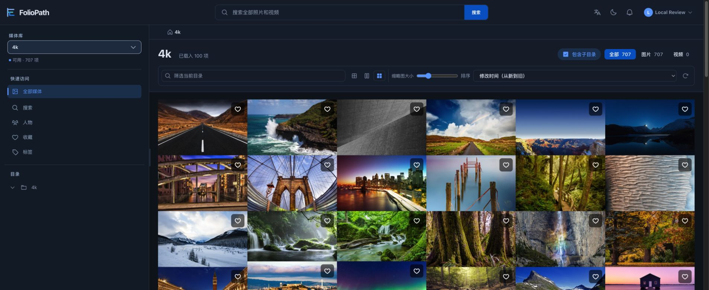
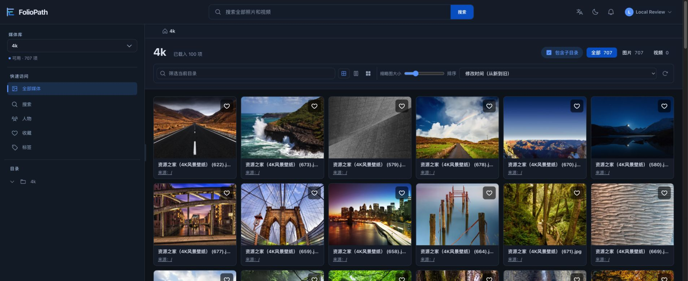
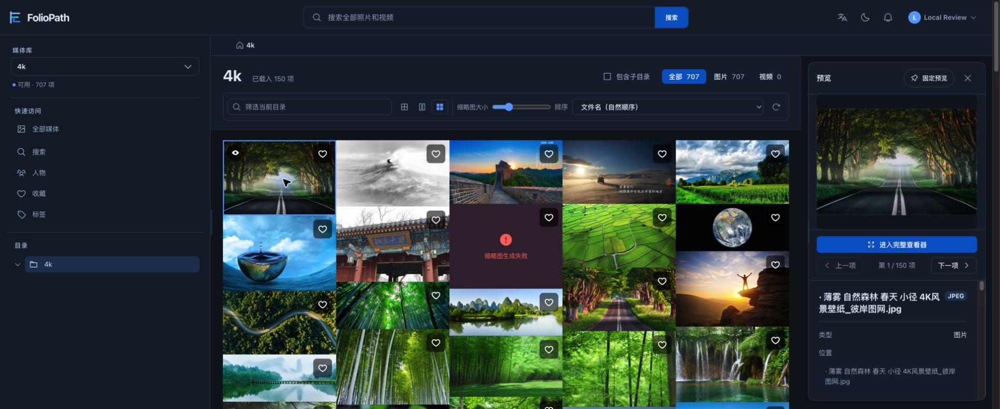
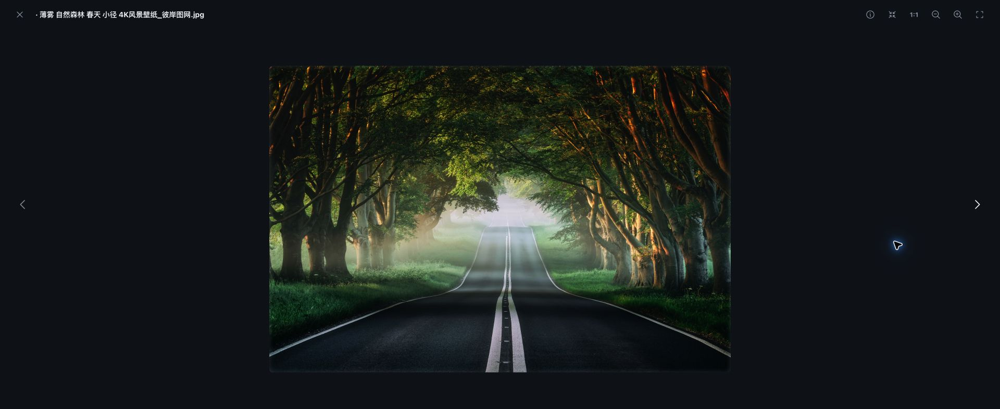
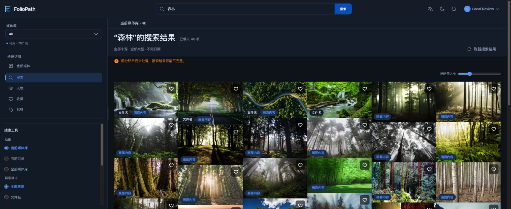
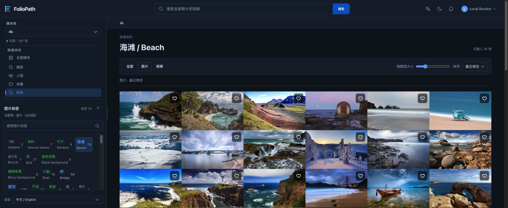
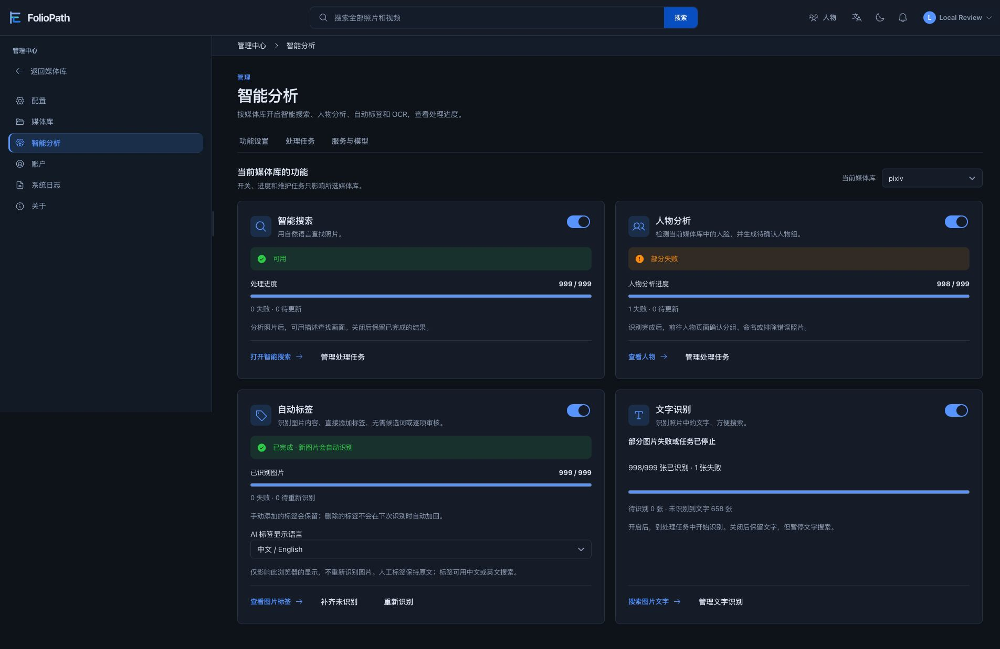
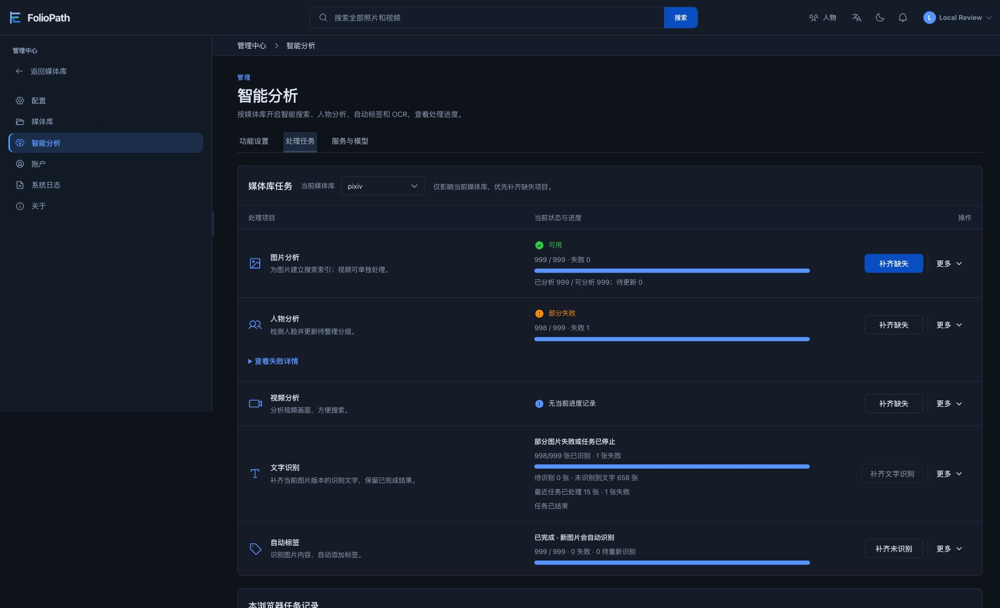
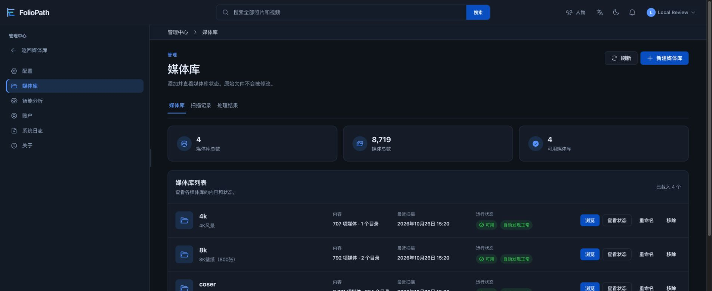
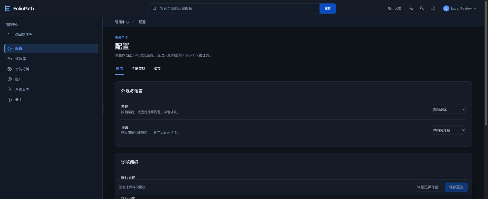

<p align="center">
  
</p>

<h1 align="center">FolioPath</h1>

<p align="center">
  <strong>Your folders. Your media library.</strong><br>
  A read-only, self-hosted photo and video browser for the archives you already have.
</p>

<p align="center">
  <strong>English</strong> · <a href="README.zh-CN.md">简体中文</a> · <a href="#quick-start">Quick start</a> · <a href="docs/README.md">Documentation</a>
</p>

<p align="center">
  <a href="LICENSE"></a>
  <a href="https://hub.docker.com/r/evanqu/foliopath"></a>
  
</p>



No re-uploading, album setup, or folder reorganization. Browse the collections you already organize by project, trip, event, or date, with search and curation on your NAS or home server.

## Browse complete sets, straight from your folders

| Core feature | What it does |
| --- | --- |
| Multiple libraries & directory tree | Select non-overlapping libraries within one media root. Preserve hierarchy, empty folders, and counts; browse a directory and all descendants together. Subfolders use a compact two-row grid, with expansion and paged loading. |
| Three gallery layouts | Switch between adaptive grid, masonry, and seamless masonry. Adjust thumbnail size and remember it in this browser. |
| Search, filters & sorting | Find filenames or paths; filter by media type, modification date, and scope. Sort by name, modification time, or file size. |
| Side preview | Inspect an image while keeping the collection visible. Pin and resize the preview; view its source directory and basic information. |
| Full viewer | Fit, zoom, pan, 1:1, previous/next, fullscreen, and basic file details. |
| Video browsing | Posters, 4- or 10-frame hover previews, and browser-native playback. No transcoding; incompatible videos keep their posters and information. |
| Favorites & manual tags | Collect media across folders, add/select/remove tags, and browse by favorite or tag without changing original files. |
| Appearance & language | Light, dark, or system theme; Simplified Chinese and English. Desktop sidebars become tool drawers on phones. |

### From a whole collection to a single image

Use the **adaptive grid** to inspect filenames and origins, or **seamless masonry** to keep the pictures flowing. Aggregated views retain a route back to the source directory.



Keep browsing with the **side preview**, then open the full viewer for a closer look.



<details>
<summary>See the full image viewer</summary>



</details>

## Find photos by content, text, tags, or people

Version 1.5 introduced intelligent search, automatic image tags, image text recognition, and people analysis. Describe a scene, search words inside a picture, or browse by tag or person—all with a local AI service. Enable each feature per library; media and queries are not uploaded to the cloud. Ordinary browsing and filename search work independently of AI.

### Combined search and image text search

- **All sources:** combine and deduplicate filename, library-relative path, visual, and enabled OCR matches, with actual match-source labels.
- **Visual content:** describe a scene in natural language. Multilingual search supports Chinese and English queries; video visuals use a separate semantic entry point.
- **Image text (OCR):** find Chinese, English, and multiword text inside processed images, with original matching lines in the preview. Enable it for a library and process its images first. Matching text follows the current image contents; video OCR is unsupported.
- **Search scope:** current library, current directory with optional descendants, or all libraries. Inspect “Why this matched” in the preview.



### Automatic tags and people curation

| Intelligent feature | What it does |
| --- | --- |
| Automatic image tags | Add content tags directly, without reviewing a suggestion queue. The 153-category photo profile supports Chinese, English, and bilingual display and lookup. |
| Manual edits take priority | Show AI/manual provenance, preserve manual tags during reprocessing, and keep removed tags suppressed. Changing display language needs no reanalysis. |
| Image tag directory | Browse tags and distinct image counts per library, search categories, and open matching photos. Counts include still images and animations. |
| People & faces | Anonymous face groups, administrator-named people, photo browsing, and explicit face assignment, removal, or exclusion. Does not identify real-world identities. |



### Separate feature settings from processing tasks

Enable search, people, automatic tags, and OCR for each library, then manage progress in the task view. Fill missing results independently; full rebuilds and clearing require explicit actions. Disabling or cancelling preserves committed progress. Disabling OCR pauses text search.



<details>
<summary>See processing tasks and progress</summary>



</details>

**AI is optional.** Run the main application on its own, or add the AI container for content search, tags, people, and OCR. Since 1.6.1, the AI setup downloads and verifies its models automatically; Settings shows preparation progress and retries. No model identity JSON or setup script is required. [Choose a setup below](#quick-start).

For planning, reserve about **2 GiB** for AI face analysis or tagging, **3 GiB** for OCR, or **6 GiB** for multilingual search and the complete profile. Separately allow about **512 MiB–1 GiB** for the main app, plus headroom for scanning, large images, the OS, and other services. These are engineering allowances, not measured minimums; see [measured scenarios and limits](docs/ai-compose.md#ai-功能内存参考).

## Your originals stay yours

- **Read-only media:** never move, rename, edit, or delete originals. Removing a library only clears its application configuration, index, curation assignments, and cache.
- **Filesystem first:** directories determine what exists. Indexes, thumbnails, and posters can be rebuilt. Offline libraries and interrupted scans retain the last reliable index.
- **Separate curation:** favorites, tags, people, and jobs live under `/app/data`. When a successful scan confirms media removal, its favorite/tag assignments are removed; tag names remain.
- **Administrator access:** first-run single-administrator setup, login, logout, and CSRF protection. Direct HTTP is intended for a trusted LAN; public exposure needs external HTTPS and access controls.
- **Maintainable processing:** monitor scans, thumbnails, and video previews; fill missing results, inspect failures and logs, and configure scan schedules, cache quota, and concurrency.



<details>
<summary>See appearance, language, and browsing preferences</summary>



</details>

## Supported Media

| Type | Formats |
| --- | --- |
| Images | JPEG (`.jpg`, `.jpeg`), PNG (`.png`), WebP (`.webp`), GIF (`.gif`) |
| Videos | MP4 (`.mp4`), MOV (`.mov`), MKV (`.mkv`), AVI (`.avi`) |

Videos are never transcoded. Playback depends on your browser's codec support. SVG, HEIC/HEIF, AVIF, and RAW are currently unsupported. Image and video processing use bounded resources and timeouts; preview failures never modify originals.

## Quick start

You need Linux `amd64` or `arm64`, Docker, and Compose v2. Ordinary browsing needs no AI container.

Create an empty directory, choose **one** of the configurations below, and save it as `compose.yaml`. Replace `/mnt/photos` with your existing media directory.

### Basic browsing

For galleries, filename search, favorites, and manual tags:

```yaml
services:
  foliopath:
    image: evanqu/foliopath:latest
    restart: unless-stopped
    environment:
      TZ: Asia/Shanghai
    ports:
      - "8080:8080"
    volumes:
      - /mnt/photos:/library:ro
      - ./data:/app/data
```

### With local AI

For intelligent search, automatic tags, people, and OCR, use version **1.6.1 or newer** with this two-container configuration instead:

```yaml
services:
  foliopath:
    image: evanqu/foliopath:latest
    restart: unless-stopped
    ports:
      - "8080:8080"
    environment:
      TZ: Asia/Shanghai
      FOLIOPATH_AI_PROFILE: standard-v1
    volumes:
      - /mnt/photos:/library:ro
      - ./data:/app/data

  machine-learning:
    image: evanqu/foliopath:latest-ai
    restart: unless-stopped
    volumes:
      - ./models/cache:/cache
      - ./models/ocr:/ocr-cache
      - ./models/scratch:/verified-cache
```

On first startup, the AI container downloads about **3.5 GB** of model files. Ordinary browsing remains available while it prepares. Check **AI Analysis → Service and models**, then enable the features you need for each library. Allow at least **8 GiB** of free disk space for models and temporary working copies.

### Start the application

```sh
docker compose up -d
```

Visit `http://<your-server-LAN-address>:8080`, create the administrator, and select directories under **Administration → Libraries**.

### Configuration

| Setting | Meaning |
| --- | --- |
| `image` | The example uses `latest`; pin a published version or digest for controlled upgrades. With AI, keep the versions paired, e.g. `1.6.1` and `1.6.1-ai`. |
| `TZ` | Set your timezone. |
| `8080:8080` | The left number is the host port, e.g. `9000:8080`. |
| `/mnt/photos:/library:ro` | Mount one read-only media root with no nested mount points. Select multiple libraries in the UI. |
| `./data:/app/data` | Accounts, settings, favorites, tags, indexes, jobs, and thumbnails. Use local disk; stop the app before backups and avoid SMB/NFS. |
| `./models/…` | AI model cache and temporary working copies. Models are prepared automatically and reused on restart. |

> **Docker Desktop:** use a Linux named volume for application data. Stop the app, back up, copy, and verify existing data before switching. Never open the live SQLite database from the host or synchronize the old data copy. See [deployment and maintenance](docs/deployment.md) and [ADR-0038](docs/adr/0038-docker-desktop-linux-sqlite-volume.md).

## Documentation & project status

Built for folder-based photography archives, family media, and NAS collections. Photo backup, phone sync, multi-user albums, image editing, and video transcoding are outside the current product scope.

- [Deployment, upgrades, backup, restore, and reverse proxy](docs/deployment.md)
- [Optional local AI setup](docs/ai-compose.md)
- [Releases](https://github.com/HappyQuQu/foliopath/releases) · [Changelog](CHANGELOG.md)
- [Security and filesystem boundaries](docs/security.md)
- [Documentation and development entry point](docs/README.md) · [Architecture](docs/architecture/README.md)

Source tooling uses Node.js **24.22.1** from `.node-version` and npm **11.19.1**. Go backend, React/TypeScript frontend, and SQLite application state; one container by default, two with optional AI.

Screenshots show the actual local deployment in dark mode on 2026-10-26. UI language is Simplified Chinese; English is also supported. Counts and failure states are instance snapshots, not model-quality or success-rate claims. [Screenshot notes](docs/screenshots/dark/README.md).

## License

[GNU Affero General Public License v3.0 or later](LICENSE) (`AGPL-3.0-or-later`)
